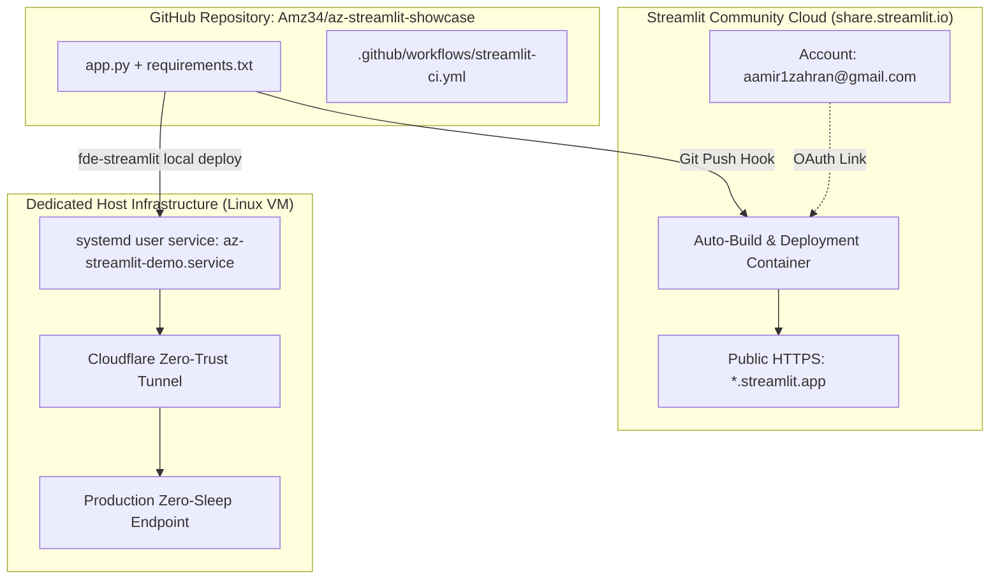

# ⚡ Az. Consultants | Enterprise AI & Streamlit Mesh

[](https://share.streamlit.io/deploy?repository=Amz34/az-streamlit-showcase&branch=main&main_module=app.py)


An enterprise-grade demonstration dashboard and production multi-agent telemetry mesh built for **Az. Consultants (Principal AI Architect: Aamir Zameer)**. 

Engineered for dual-track deployment across **Streamlit Community Cloud (`share.streamlit.io`)** and **Host Enterprise Linux Infrastructure**.

---

## 🎯 Architecture Overview



---

## 🚀 Deployment Options

### Target 1: Streamlit Community Cloud (share.streamlit.io)
Streamlit Community Cloud deploys directly from GitHub repositories without requiring manual server setup:
1. **Direct Provisioning URL**:
   [Deploy on Streamlit Community Cloud](https://share.streamlit.io/deploy?repository=Amz34/az-streamlit-showcase&branch=main&main_module=app.py)
2. **Continuous Deployment**:
   Any `git push origin main` automatically triggers Streamlit Cloud to pull the newest code, install dependencies from `requirements.txt`, and deploy within 60 seconds.

### Target 2: Host Infrastructure (Linux VM + Cloudflare Tunnel)
For enterprise workloads that require zero-sleep uptime, dedicated hardware, or internal VPC access:
```bash
# Start local host service
systemctl --user start az-streamlit-demo.service

# View live telemetry & logs
journalctl --user -u az-streamlit-demo.service -f
```

---

## 🛠 Project Structure

```text
az-streamlit-showcase/
├── .streamlit/
│   └── config.toml          # Dark mode styling and server parameters
├── .github/
│   └── workflows/
│       └── streamlit-ci.yml # Automated linting and headless smoke test
├── app.py                   # Primary application entrypoint
├── streamlit_app.py         # Entrypoint alias for Streamlit Community Cloud
├── requirements.txt         # Pinned Python package dependencies
├── fde-streamlit.sh         # Autonomous deployment CLI script
└── README.md                # Architectural documentation and runbook
```

---

## 👨‍💻 Author
**Aamir Zameer**  
Principal AI Architect | Az. Consultants  
Email: `aamir1zahran@gmail.com`  
GitHub: [@Amz34](https://github.com/Amz34)
